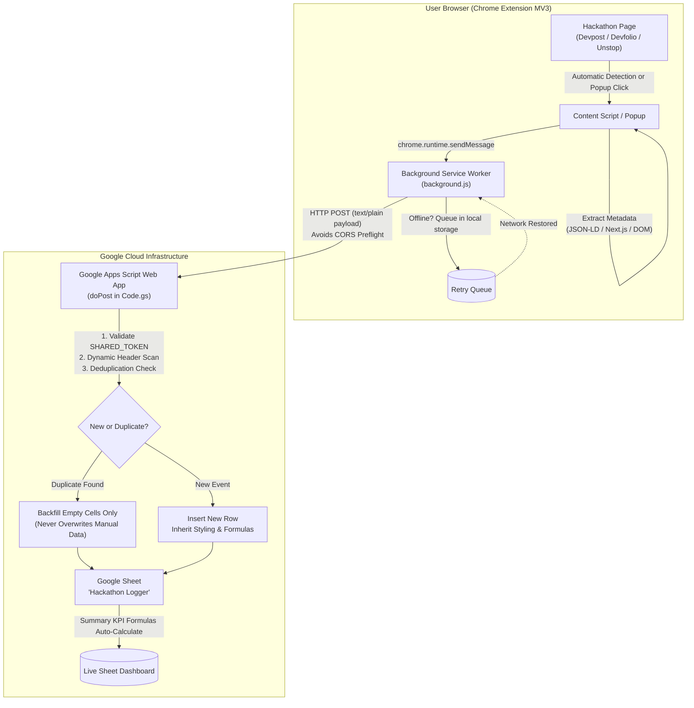

# ⚡ Hackathon Logger

> **Effortless, zero-friction hackathon tracking directly from your browser to your Google Sheet.**  
> Automatically logs registrations or lets you log any hackathon with 1 click. No popups, no manual copy-pasting across tabs.

---

## 📦 Quick Download & Installation (< 2 Minutes)

Anyone can use this extension right away without writing code!

### 1. Download the Extension
Click the link below to download the extension package:

👉 **[⬇️ Download HackathonLogger-extension.zip](HackathonLogger-extension.zip)**  
*(Alternative direct link on GitHub: `https://github.com/<YOUR-USERNAME>/HackathonLogger/raw/main/HackathonLogger-extension.zip`)*

### 2. Install in Google Chrome
1. Extract (unzip) the downloaded `HackathonLogger-extension.zip` file.
2. In Google Chrome, go to:
   ```text
   chrome://extensions
   ```
3. In the top-right corner, turn **ON** the **Developer mode** toggle.
4. In the top-left corner, click **Load unpacked**.
5. Select the extracted **`extension`** folder.
6. Click the puzzle icon (🧩) in Chrome's toolbar and pin **Hackathon Logger** (📌) for easy access.

---

## 🚀 5-Minute Setup: Google Sheet & Backend

Follow these simple one-time steps to connect the extension to your Google Sheet:

### Step 1: Prepare Your Google Sheet
1. Open or create your Google Sheet (e.g. titled **`Hackathon Logger`**).
2. Ensure your table has the following 7 header columns (located anywhere in the sheet, e.g. row 5):
   ```text
   Hackathon Name | Category | Application Deadline | PPT Submission Deadline | Status | Platform / Format | Event Link
   ```
   *(Any summary KPI cards or formulas at the top of your sheet like `TOTAL CONTESTS` or `OPEN APPLICATIONS` are preserved and will auto-expand).*

### Step 2: Deploy Google Apps Script Web App
1. In your Google Sheet, click **Extensions** → **Apps Script**.
2. Replace any starter code in the editor with the entire contents of [`apps-script/Code.gs`](apps-script/Code.gs).
3. At line 20, set your secret token passphrase:
   ```javascript
   var SHARED_TOKEN = 'your_custom_secret_passphrase_here';
   ```
4. Click **Save** (💾).
5. Click **Deploy** (top-right blue button) → **New deployment**:
   - Click the gear icon (⚙️) next to *Select type* and choose **Web app**.
   - **Execute as**: `Me`
   - **Who has access**: `Anyone` *(required so your browser extension can send data to your sheet)*.
6. Click **Deploy**, click **Authorize access**, choose your Google account, click **Advanced** → **Go to Hackathon Logger (unsafe)**, and click **Allow**.
7. **Copy the Web App URL** (e.g. `https://script.google.com/macros/s/AKfycb.../exec`).

### Step 3: Connect Extension
1. Right-click the **Hackathon Logger** icon in Chrome → select **Options** (or go to `chrome://extensions` → *Details* → *Extension options*).
2. Paste your **Apps Script Web App URL** and your **Secret Token**.
3. Click **Save Settings**, then click **Test Connection**.
4. You should see a green confirmation: **`✓ Connection and authentication successful! Sheet is ready.`**

---

## 🎯 How to Use

Hackathon Logger gives you two flexible ways to track events:

### Method A: Zero-Click Automatic Logging
- Navigate to any supported platform (**Devpost**, **Devfolio**, **Unstop**, **Hack2skill**, **DoraHacks**, **MLH**).
- When you register or apply for a hackathon, the extension detects the registration and logs it automatically in the background.
- A discreet toast appears in the bottom right corner: **`✓ Logged to sheet`**.

### Method B: 1-Click Toolbar Popup (Instant Verification)
- On any hackathon page, click the **Hackathon Logger icon** in Chrome's toolbar.
- The popup instantly parses the page and previews all 7 fields:
  - **Hackathon Name**
  - **Category** (auto-standardized into *AI & Cloud*, *FinTech & Web3*, etc.)
  - **Application Deadline** (ISO format `YYYY-MM-DD`)
  - **PPT Submission Deadline** (project submission cutoff)
  - **Status** (*Open* / *Closed*)
  - **Platform / Format** (e.g. *Devpost (Online)*, *Devfolio (In-Person / Goa)*)
  - **Event Link** (canonical URL with tracking tags stripped)
- Click **`⚡ Log This Hackathon to Sheet`**.
- Instant confirmation appears right in the popup!

---

## 🛡️ Smart Sheet Protection Rules

1. **Summary Block Safety**: The script scans for `"Hackathon Name"` dynamically and appends new rows after your last data row via `insertRowAfter`, ensuring `COUNTIF`, `COUNTA`, and summary formulas expand automatically.
2. **Formatting & Formulas Preserved**: Clones fonts, borders, alignments, data validation dropdowns, and relative `R1C1` formulas (such as dynamic `Status` formulas) from the row above.
3. **Smart Deduplication & Patching**: Normalized event links are checked first, followed by Sørensen-Dice bigram fuzzy title matching. If a duplicate is detected, it **only backfills blank cells** without overwriting your manual notes.

---

## 🌐 Supported Platforms

| Platform | URL Pattern | Detection Strategy | Extraction Method |
| :--- | :--- | :--- | :--- |
| **Devpost** | `*.devpost.com/*` | Form submissions, register buttons, confirmation redirects | JSON-LD Event schema + OpenGraph meta |
| **Devfolio** | `devfolio.co/*` & subdomains | Apply button clicks, API responses | Next.js `__NEXT_DATA__` deep hydration parser |
| **Unstop** | `unstop.com/hackathons/*` | Registration buttons, multi-step wizards | Embedded Nuxt/Next state + semantic chips |
| **Hack2skill** | `hack2skill.com/*` | Apply triggers & schedule timeline | Hydrated JSON scripts + DOM selectors |
| **DoraHacks** | `dorahacks.io/hackathon/*` | Registration CTA & GraphQL / REST intercept | Apollo Client cache + track metadata |
| **Major League Hacking (MLH)**| `mlh.io/events/*` | Event links & registration outbound | Event schema + location / mode parsing |

---

## 🏗️ Architecture



---

## 📁 Repository Structure

```
HackathonLogger/
├── HackathonLogger-extension.zip # Ready-to-use zip package for Chrome
├── apps-script/
│   └── Code.gs                  # Bound Google Apps Script Web App
├── extension/
│   ├── manifest.json            # Manifest V3 configuration & host permissions
│   ├── config.js                # Settings, category mappings, thresholds
│   ├── background.js            # Service worker: retry queue & network dispatch
│   ├── content.js               # Content script: passive scraping & listeners
│   ├── injected.js              # Network interceptor for fetch / XHR
│   ├── toast.css                # Minimal status toast styles
│   ├── popup/
│   │   ├── popup.html           # 1-click manual trigger popup UI
│   │   └── popup.js             # Live preview and manual logging script
│   ├── adapters/                # Platform adapters (Devpost, Devfolio, Unstop, etc.)
│   ├── utils/                   # Date parser (IST support) and text utilities
│   └── options/                 # Options dashboard (URL, Token, retry queue, test button)
├── README.md                    # Setup and user guide
└── TEST_PLAN.md                 # Test scenarios & fragile selectors reference
```

---

## 🔒 Security & Privacy

- **No Passwords or Credentials**: Does not require Google OAuth credentials or access to your private Google Account.
- **Shared Secret Verification**: Requests to your Google Apps Script are secured with your private `SHARED_TOKEN`.
- **Zero Personal Data Stored**: Scrapes only publicly visible hackathon metadata (event title, deadlines, links). Form field contents or personal details are never read or sent.
- **Local Processing**: All scraping and formatting runs 100% locally on your machine.

---

## 📄 License

MIT License. Free to use, modify, and share!
